# NV-Diamond Quantum Magnetometer Demonstrator

**Seeing steel inside concrete with a diamond quantum sensor.**
A mobile scanning cart that magnetizes reinforced concrete and measures the magnetic stray field with an **NV-center diamond vector magnetometer**, fused with two conventional MEMS magnetometers, to locate hidden rebars and stirrups without drilling or X-ray.

Built by **Pavan G Kulkarni** at **MPA, Materialprüfungsanstalt Universität Stuttgart**, with the quantum sensor from **Advanced Quantum**, and exhibited live at **[Quantum Effects 2026](https://www.messe-stuttgart.de/quantum-effects/)**, Messe Stuttgart, 6–7 October 2026.

<p align="center">
  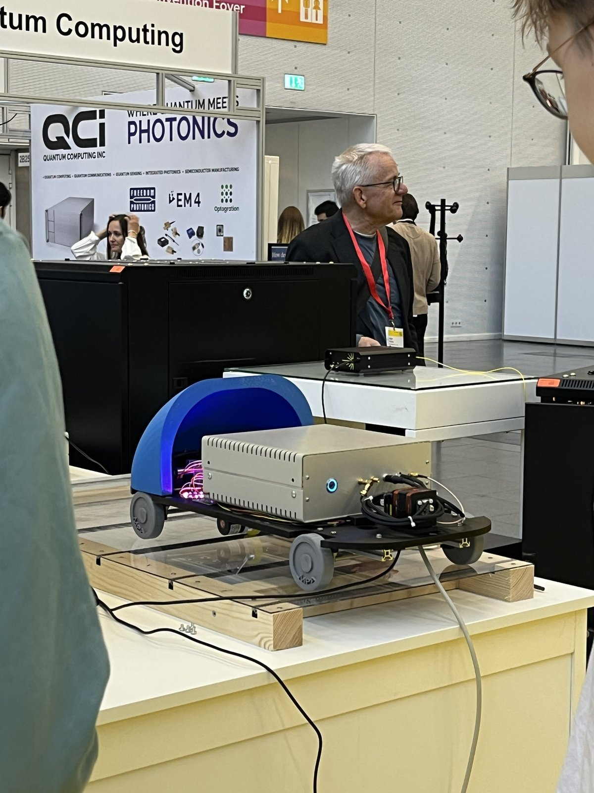
  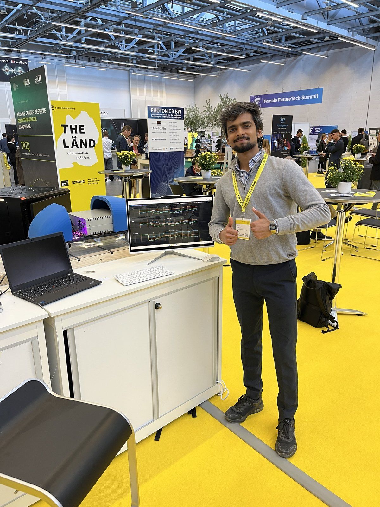
</p>

---

## What it does

1. **Magnetize.** An electromagnet yoke on the cart magnetizes the steel reinforcement in the beam.
2. **Sense.** As the cart rolls, the NV-diamond magnetometer measures the stray field (magnetic flux leakage) in three axes. Two MEMS magnetometers (LIS2/LIS3) record the same scan as a conventional reference, and a spring-loaded encoder wheel gives the position in cm.
3. **Detect.** A detection engine finds each bar from the derivative of the field, fuses all sensors and reports bar position, spacing and confidence live.
4. **Show.** Two live web dashboards: an engineer view for calibration and raw signals, and a bilingual (DE/EN) big-screen visitor view.

## The quantum part: NV-center magnetometry

A nitrogen-vacancy (NV) center in diamond is a spin-1 defect whose ground state has a zero-field splitting of about **2.87 GHz** between the m<sub>s</sub> = 0 and m<sub>s</sub> = ±1 levels. Green light polarizes the spin and the red fluorescence depends on the spin state, so sweeping a microwave across the resonance gives an **optically detected magnetic resonance (ODMR)** spectrum. A magnetic field shifts the resonances by the Zeeman effect (about 28 GHz/T), so tracking them measures the field.

The diamond is an **ensemble**: NV centers sit along the four crystallographic ⟨111⟩ axes, and each orientation projects the field differently. Resolving the orientation **sub-ensembles** turns one diamond into a **vector magnetometer** (Bx, By, Bz). Each line is further split into a triplet by the hyperfine coupling to the <sup>14</sup>N nucleus (about 2.1 MHz).

For fast, low-noise readout the sensor runs **lock-in detection** on each sub-ensemble resonance. The output is the derivative of the ODMR line, whose slope at the zero crossing converts signal to field. That slope has to be calibrated, which is what the two-stage calibration in this project does.

### Live ODMR and calibration at the stand

<p align="center">
  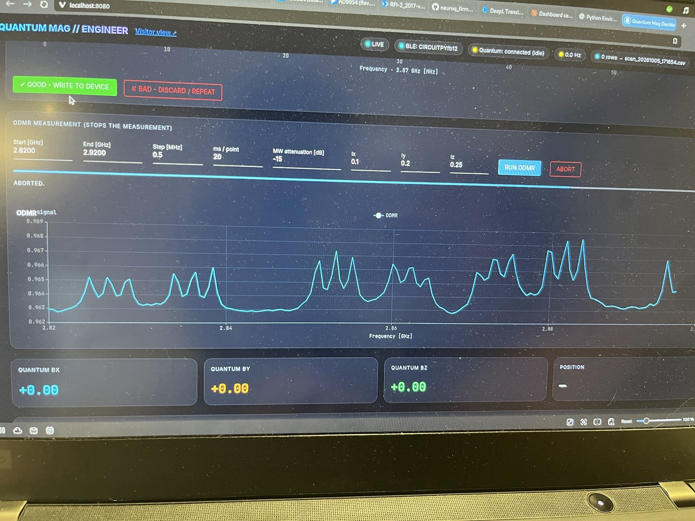
  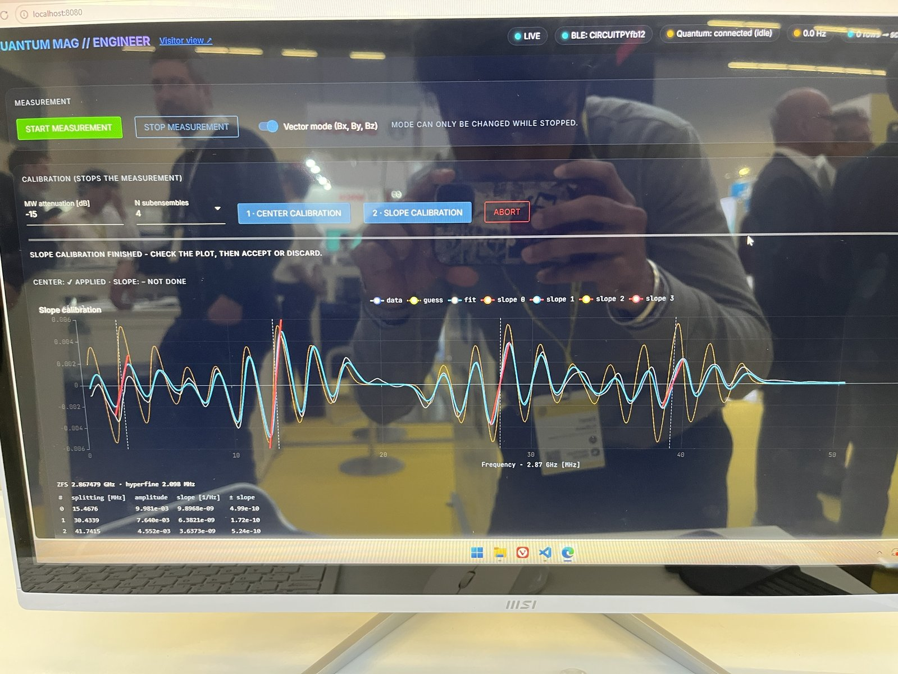
</p>

**Measured on the demonstrator** (slope calibration at Quantum Effects 2026, 4 sub-ensembles, MW attenuation −15 dB):

| Quantity | Value |
|---|---|
| Zero-field splitting | 2.867479 GHz |
| <sup>14</sup>N hyperfine constant | 2.098 MHz |
| Sub-ensemble splittings | 15.4676 / 30.4339 / 41.7415 MHz (+ a fourth) |
| Lock-in slopes | 9.90 × 10⁻⁹ / 6.38 × 10⁻⁹ / 3.64 × 10⁻⁹ Hz⁻¹ |

### Two-stage calibration (`src/calibration.py`)

| Stage | What runs on the sensor | What is fitted |
|---|---|---|
| **1. Center** | 1000-point sweep, hyperfine modulation off | Zero-field splitting, hyperfine constant, splitting, amplitude and linewidth of each sub-ensemble (Lorentzian-derivative triplet model, four sign hypotheses, best residual wins) |
| **2. Slope** | 500-point sweep, hyperfine on | Gaussian-derivative model with five hyperfine components, then a linear fit of the slope at each zero crossing (±0.6 MHz window) |

Nothing is written to the sensor until the operator inspects the fit and presses **"Good – write to device"**. Raw sweeps are saved as `.pys` files and can be replayed offline with `ensemble_guesser.py` and `slope_determination.py`.

## Hardware

<p align="center">
  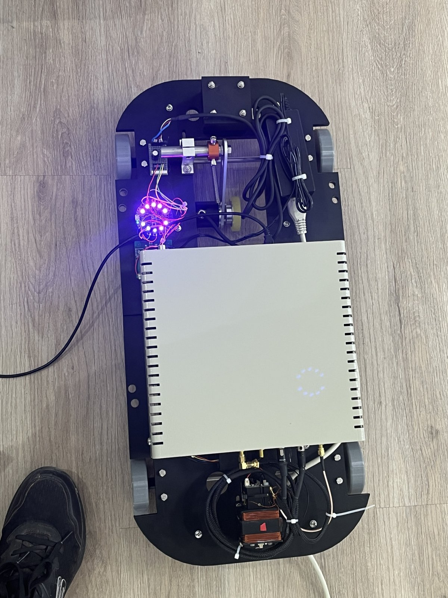
</p>

- Cart chassis designed in **SolidWorks**, with **3D-printed** wheels, hood and mounts
- **Electromagnet yoke** (copper winding) with the NV sensor head between the poles, for active magnetization
- **Spring-loaded encoder wheel** with belt drive for position
- **Advanced Quantum** NV-ensemble magnetometer and electronics, connected over UART at 1 Mbaud
- **CircuitPython BLE board** with two ST MEMS magnetometers (LIS2, LIS3), streaming position and field over the Nordic UART Service

## Software architecture

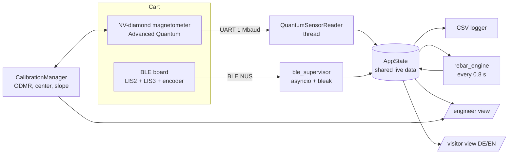

| File | Role |
|---|---|
| `src/dashboard.py` | NiceGUI app: sensor readers, auto-reconnecting asyncio supervisors, CSV logging, demo and replay modes, engineer page |
| `src/visitor_page.py` | Big-screen exhibition page: beam "X-ray" view, four key numbers, quantum vs conventional sensor side by side, attract screen |
| `src/calibration.py` | ODMR sweeps and the two-stage center/slope calibration with review-before-write |
| `src/ensemble_guesser.py` | Center calibration analysis: symmetry search for the zero-field splitting, group finding, multi-ensemble fit |
| `src/slope_determination.py` | Slope calibration analysis: hyperfine-resolved model and slope fits |
| `src/rebar_engine.py` | Detection and sensor-fusion engine (pure NumPy/SciPy, unit-testable) |
| `src/Rebar_detection.py` | Faithful port of the institute's reference stirrup-detection algorithm |
| `src/demo_source.py` | Simulated scans with known ground truth (demo mode and tests) |
| `src/ble_live_plot_and_log.py` | Earlier stand-alone BLE + magnetometer logger |
| `src/test_engine.py`, `src/test_original_equivalence.py` | Validation tests |

## Detection and sensor fusion (`src/rebar_engine.py`)

Two selectable methods:

- **`original`** reproduces the institute's reference algorithm exactly (`np.gradient`, prominence threshold, sign convention per scan pass). `test_original_equivalence.py` proves the port gives bit-identical results.
- **`robust`** is built for live data:
  1. Resample onto a 1 cm position grid, so results do not depend on cart speed or BLE rate
  2. Split the scan at position gaps instead of interpolating across them
  3. Hampel filter against single-sample spikes
  4. Savitzky–Golay derivative over a window set in cm
  5. Threshold = max(fixed threshold, k × measured noise), with noise estimated from second differences
  6. Locate each bar at the zero crossing between the two derivative lobes (the centre of the magnetic bump)
  7. Fuse channels by inverse-variance weighting; a bar is **confirmed** when at least 2 sensors agree within 4 cm, and gets a confidence and an uncertainty

### Validation on simulated scans with known ground truth

`python test_engine.py` (robust method, 8 rebars per scan):

| Scenario | Bars found | False positives | Position RMS |
|---|---|---|---|
| Clean scan | 8/8 | 0 | 0.15 cm |
| Artefacts (sparse start, 35 cm dropout, spikes), 8 seeds | 56/64 (87.5 %) | 0 | 0.5–1.1 cm |
| Quantum sensor offline | 8/8 | 0 | 0.19 cm |
| Slow (8 Hz) and fast (25 Hz) scans | 8/8 | 0 | 0.15 cm |

These figures are from **simulation**, not from field measurements. Real scans recorded on 30 September 2026 are included in `data/sample_scans/` but have no independent ground truth yet.

## Dashboards

<p align="center">
  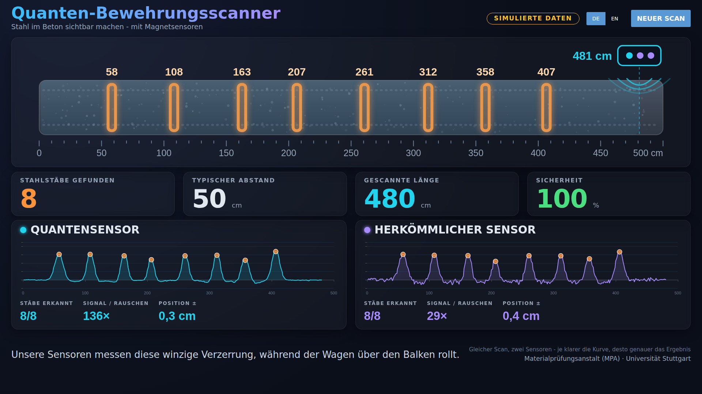
</p>

<p align="center">
  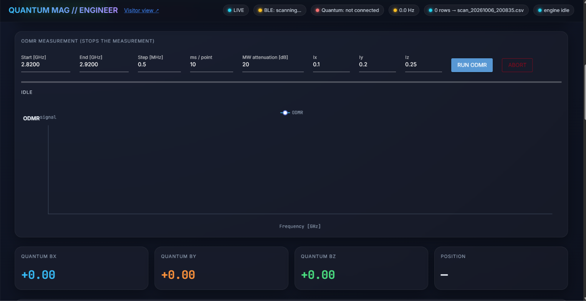
  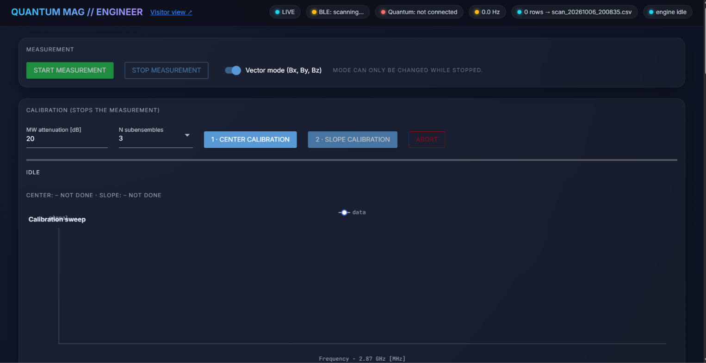
</p>

The visitor screenshot above is labelled **"Simulierte Daten"**: it shows the demo mode.

## Run it

```bash
conda env create -f environment.yml && conda activate quanten-scanner
# or: pip install -r requirements.txt

cd src
python dashboard.py --demo                                   # no hardware: simulated scan
python dashboard.py --replay ../data/sample_scans/scan_20260930_105010.csv --loop
python dashboard.py --name CIRCUITPY --mag-port COM18        # live: BLE board + quantum sensor
python test_engine.py                                        # validation
python test_original_equivalence.py
```

Then open <http://localhost:8080/engineer> and <http://localhost:8080/visitor>.

## Data

`data/sample_scans/` holds recorded CSV scans from 30 September 2026. Columns: `timestamp, Position` (cm), `lis2_Bx/By/Bz_G`, `lis3_Bx/By/Bz_G` (gauss), `quantum_Bx/By/Bz` (a.u.), `quantum_valid`.

## At Quantum Effects 2026

<p align="center">
  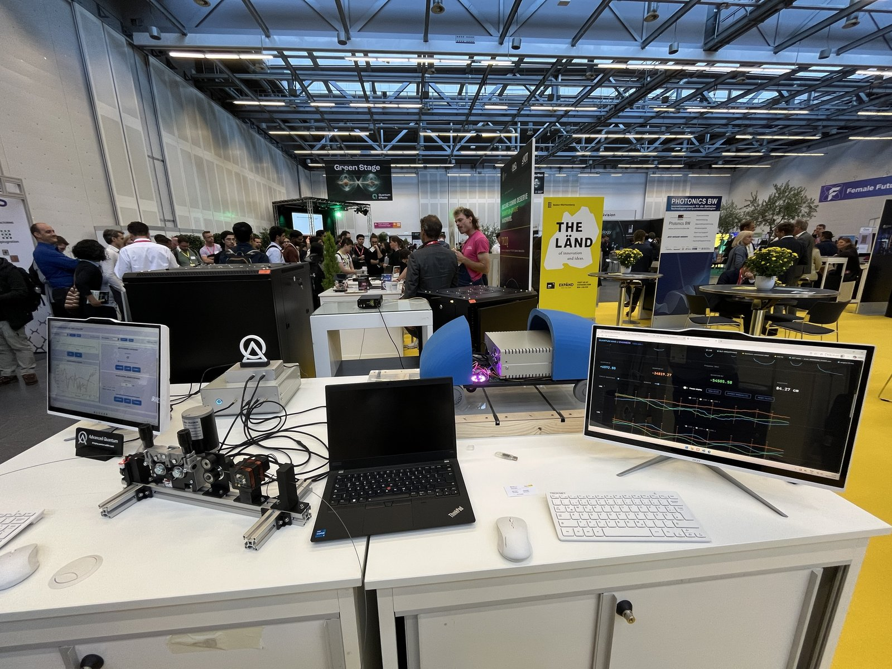
  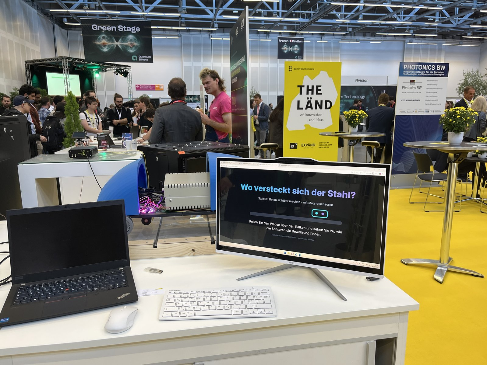
</p>

## Acknowledgements

- **MPA, Materialprüfungsanstalt Universität Stuttgart**: host institute, application and reference detection algorithm
- **Advanced Quantum**: NV-diamond quantum sensor, hardware and calibration know-how
- **Quantum Effects 2026** and **Quantum BW**: exhibition

## Author

**Pavan G Kulkarni**: M.Sc. Electrical Engineering (Nano & Opto Electronics), Universität Stuttgart; Research Assistant at MPA Stuttgart

[LinkedIn](https://www.linkedin.com/in/pavan-g-kulkarni-485469219) · [GitHub](https://github.com/Pxvan09)
